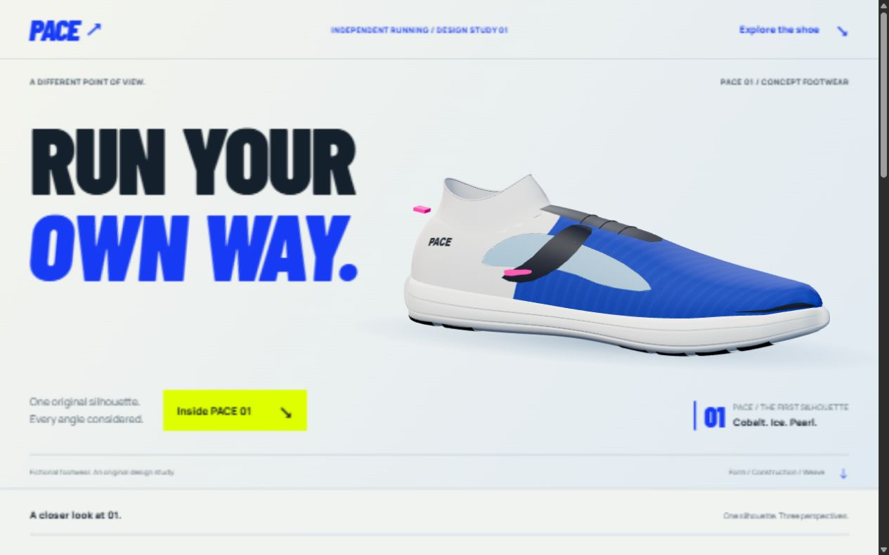
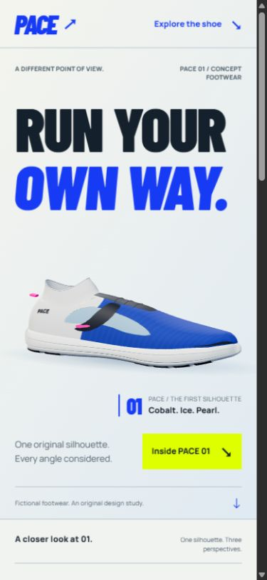
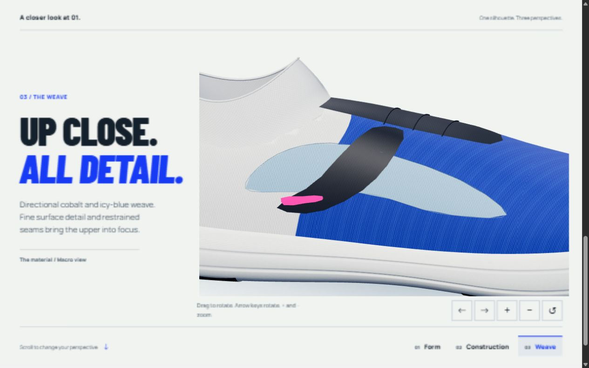

# PACE — original running-shoe visual study

PACE is a fictional running brand built to demonstrate frontend composition, original product rendering and responsive interaction. This local milestone contains a hero and one product-detail scroll sequence. It does not include shopping, sizes, a bag, payments or backend services.

The redesigned PACE 01 uses a tapered running silhouette, fitted knit collar, integrated instep, directional cobalt/ice fabric, pearl heel, black support panels and a small pink accent. Every view comes from the same original geometry.

## Run locally

Requirements: Node.js 22.12+ and npm. Dependencies are project-local.

```powershell
npm ci
npm run dev
```

The configured local address is `http://127.0.0.1:4180/`. Vite uses a strict port and does not silently select another port. To inspect a production build:

```powershell
npm run build
npm run preview
```

These commands bind to loopback. Nothing has been deployed or published.

Useful routes on the current page:

| Route | Purpose |
| --- | --- |
| `/?motion=full` | Full-motion visual review |
| `/?motion=reduce` | Complete reduced-motion composition |
| `/?view=static` | Force the static asset fallback |
| `/?motion=full&profile=1` | Explicit live-browser timing sample |
| `/?motion=full&inspect=1` | WebGL context-loss test control |

The normal root URL respects the operating system's motion preference. Studio and baseline tools are available with `npm run dev`. For their separate built review output, run `npm run build:review`, then `npm run preview -- --outDir dist-review` after stopping the current preview. Production `dist/` includes only the current page, its four posters, used fonts and third-party notices; historical diagnostics are excluded.

## What to review

- Expressive typography, a product-led opening and a compact three-perspective detail composition.
- Native scrolling mapped directly to a deterministic camera path.
- Mouse drag, keyboard rotation/zoom/reset and labelled viewer controls.
- Mobile resolution limits, no idle render loop, hidden/offscreen suspension.
- A complete static page for reduced motion, short viewports and WebGL failure.





[Desktop and phone before/after gallery](docs/refinement/compare.html). Screenshots are review artifacts, not performance evidence. The final page was inspected in the in-app browser at 1280 × 800, 390 × 844 and a short 320 × 620 viewport. The short viewport uses the complete static composition. None of these layouts had horizontal overflow. Measurements and their limits are documented below.

## Implementation

The main page uses Vite, TypeScript and Three.js. There is no React state or React scroll update. GSAP remains in the isolated old baseline, not the current page controller. Mediabunny is used only by the developer-facing asset studio's optional offline video export.

One demand-driven animation-frame callback consumes the latest native scroll position, updates the camera and renders. There is no scroll-smoothing replacement, scrub catch-up tween or second renderer loop. A fixed canvas and interpolated viewport keep the asset continuous between hero and detail.

The procedural shoe uses shared geometry and directional texture/normal maps. It is rendered in real time and exported to fallback posters from the same cameras. Font license files remain in `public/fonts`.

See [engineering notes](docs/refinement/ENGINEERING.md) for architecture, accessibility, asset construction, performance methodology and remaining limits.

## Measured results and limits

Actual local samples used the Codex in-app browser at 1280×800, DPR 1, with native wheel events driven through UI automation.

| Observation | Original baseline | Refined version |
| --- | ---: | ---: |
| Draw calls in captured view | 22 | 8 |
| Drawn triangles in captured view | 56,870 | 12,838 |
| Warm render CPU median | 0.3 ms | 0.2 ms |
| Warm render CPU p95 | 0.6 ms | 0.7 ms |
| Constructor setup | 200.5 ms | 202.1 ms |
| Render submissions sampled | 25 | 10 |

The refined sample recorded 10 scroll events and 20 wheel events over 51.45 seconds. Its rAF gaps varied from a 4.2 ms median to a 1,004.2 ms maximum. A repeated original-baseline sample again had approximately one-second median scheduling gaps.

This is evidence of variable browser/environment scheduling interacting with the tested source. It is not a controlled FPS comparison or proof of GPU saturation. CPU submission time is not GPU completion time. Setup did not improve in these samples, and the refined first render still cost 72.7 ms. No 60 fps, foreground-Chrome, physical-phone or Lighthouse result is claimed.

Raw evidence:

- [Original baseline](docs/refinement/baseline-iab.json)
- [Repeated baseline](docs/refinement/baseline-repeat-iab.json)
- [Refined runtime](docs/refinement/after-iab.json)

Completed in-app-browser checks:

- Mouse dragging, keyboard rotation and zoom, Home reset, and alternating control-button input.
- Rapid perspective selection in the order 2 → 3 → 1 settled on perspective 1.
- Repeated Reduced → Full changes retained exactly one canvas.
- Actual WebGL context loss displayed all three static product images successfully.
- Browser Back and Forward restored the root and `#details` positions at scroll offsets 0 and 684, with one canvas.
- The phone-sized layout had 44 × 44 CSS-pixel orbit controls. The final console check reported no errors.

Hidden-tab behavior and physical touch gestures were reviewed in source but were not verified live. Chrome automation and full-page live recording were unavailable. These viewport checks are not physical-phone tests.

## Asset editing and verification

```powershell
npm run check
npm run build
node tools/check-geometry.mjs
```

The geometry check verifies finite attributes and shared geometry references across internal material palettes; it does not validate visual realism.

To regenerate posters, use the studio's Hero, Side, Three-quarter and Macro views. Export transparent PNGs into `docs/refinement/render-source/` as `hero.png`, `side.png`, `threequarter.png` and `macro.png`. Then run:

```powershell
python tools/optimize-posters.py
```

That optional asset tool requires Pillow and encodes the PNG renders as WebP in `public/renders/`. The PNG intermediate avoids alpha-edge artifacts observed with Chromium's direct WebP encoding. All four delivered posters were regenerated from the frozen final asset after the insole adjustment.

Live canvas capture and offline camera exports are labelled separately in the studio. A rendered video is never used as proof that the live page scrolls smoothly.

## Scope and preservation

The recoverable original milestone is preserved locally, outside Git, at `checkpoints/2026-10-01-before-shoe-redesign/`. This refinement remains entirely inside PACE. The later publication review is limited to Handheld Studio, Sona and PACE.

The product is fictional, with no testimonials, footwear performance claims, real checkout or publication. The older `README.txt` describes the first milestone; this README and the refinement engineering notes describe the current redesign.

## Publication preparation

The repository is prepared for KareemAl1. Publishing is pending review. vercel.json declares a Vite build with output in dist; no account is linked and no live domain is assigned. The root third-party notice URL includes the exact Three.js MIT and font OFL texts. The build also generates notices for bundled dependencies. No project-wide open-source license has been selected.
