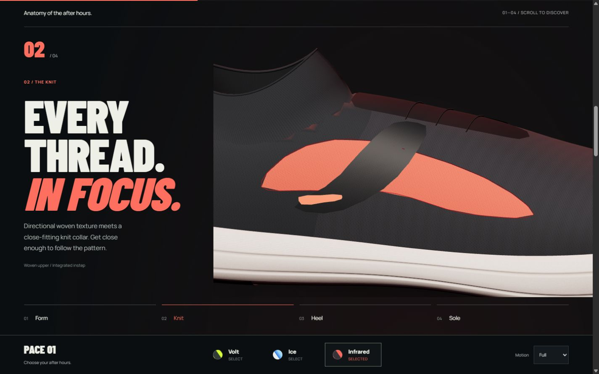
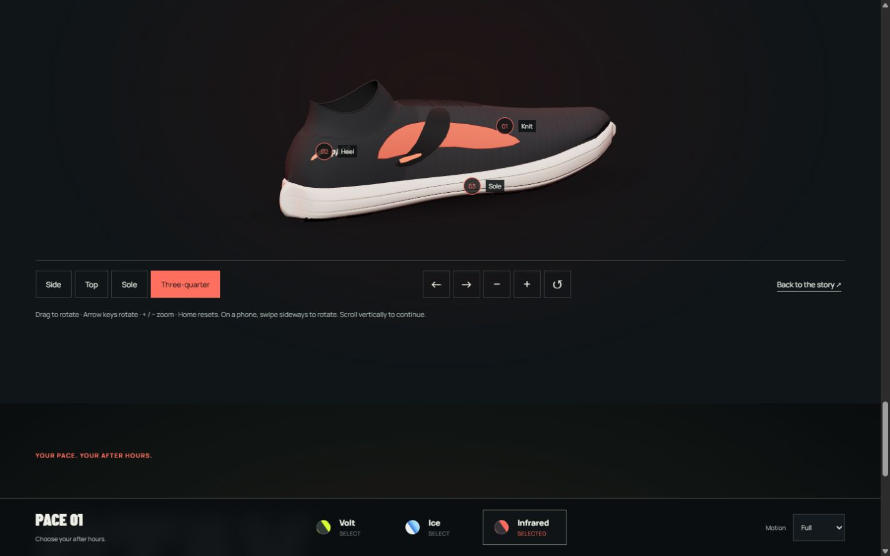
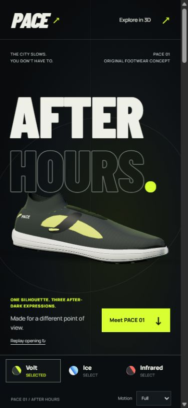

# PACE: After Hours

A launch page for a running shoe that doesn't exist. One 3D shoe moves through four chapters as you scroll, form, knit, heel and sole, and then hands you the controls.

**[Live site](https://pace-studio-zeta.vercel.app)**


## What it does

- **Scroll story.** Native scrolling drives the camera through four chapters. Scroll back up and every move reverses cleanly.
- **Explore mode.** Drag or use the keyboard to rotate and zoom, jump between camera presets and open material hotspots.
- **Three finishes.** Volt, Ice and Infrared swap materials and lighting on the same model without reloading it, and a swap can be interrupted halfway.
- **Works without 3D.** With Reduce Motion on, or if WebGL fails, the page shows a full image version rendered from the same model and cameras.

| Knit chapter | Explore mode | Phone |
| --- | --- | --- |
|  |  |  |

## How it's built

- **TypeScript, Three.js and Vite.** No framework.
- **The shoe is procedural.** The sole, upper and panels are generated in code, with texture and normal maps for the knit.
- **One render scheduler.** A single scheduler owns story progress and Explore input. The renderer only draws when something changed, so an idle page costs almost nothing.
- **A small studio page** (`studio.html`) renders the poster images for the no-WebGL version from the real model.

## Run it

```sh
npm ci
npm run dev
```

Open http://127.0.0.1:4180. Helpful URLs:

- `?motion=reduce` shows the image version
- `?view=static` forces the page without 3D
- `?finish=ice` opens a specific finish

```sh
npm run build                  # typecheck and production build
node tools/check-geometry.mjs  # validates the generated shoe
```

To rebuild the poster images, export the views from `studio.html` into `assets/render-source/`, then run `python tools/optimize-posters.py`.

The shoe, brand and copy are original. Font licenses are in `public/fonts/`, and third-party notices are in `public/THIRD_PARTY_NOTICES.txt`.
