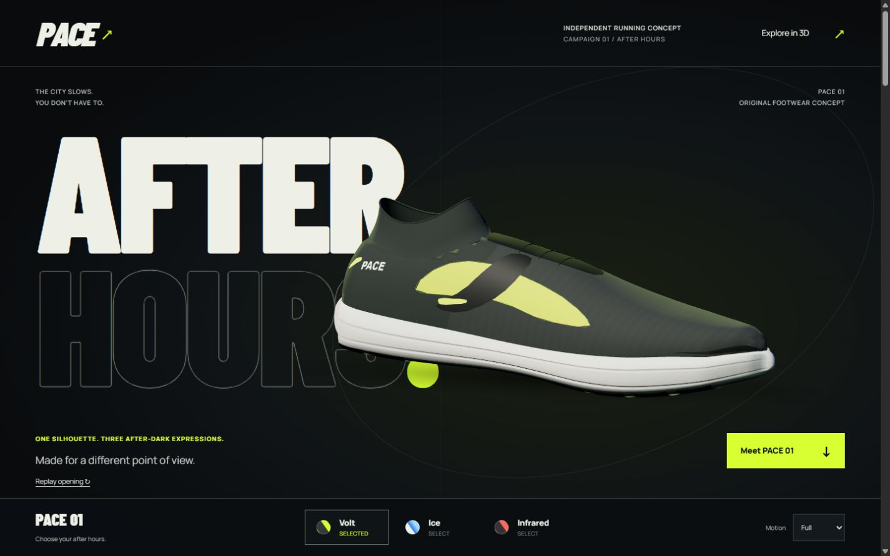
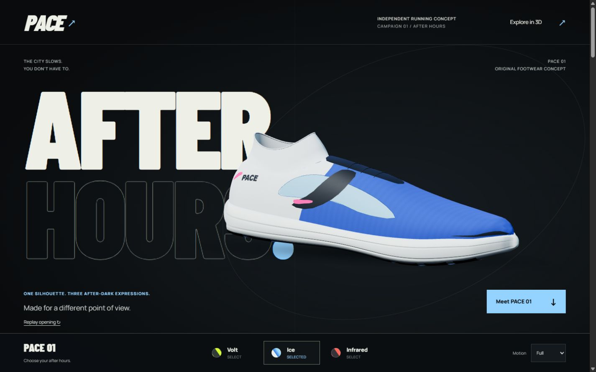
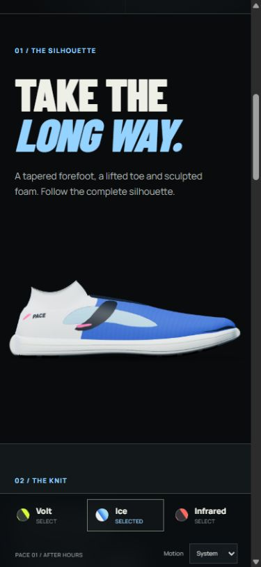

# PACE — After Hours

An original fictional running-brand campaign built to demonstrate frontend art direction, responsive composition and interactive 3D. One shoe moves from an oversized typographic opening through its form, knit, heel and sole, then into manual inspection.

**Live:** [pace-studio-zeta.vercel.app](https://pace-studio-zeta.vercel.app/) · **Source:** [KareemAl1/pace-studio](https://github.com/KareemAl1/pace-studio)

Published on Vercel with the public GitHub repository connected on `main`. The campaign includes three finishes and product exploration. Shopping, size selection, a bag, checkout and backend services are outside the implemented scope.



## Experience

- A brief, skippable opening with immediately visible content and replay control.
- Native scrolling through four product chapters, with reversible camera movement and chapter navigation.
- Explicit Explore mode with drag, keyboard rotation/zoom, camera presets and material hotspots.
- Volt, Ice and Infrared finishes using the same geometry, with interruptible material and lighting transitions.
- A complete image story for reduced motion and WebGL failure, with deliberate mobile compositions.

The product, geometry, panel shapes and generated material maps are original. The campaign makes no footwear performance claims and contains no invented testimonials. Reference research and the distinction between observed visuals and publisher descriptions are recorded in the [reference audit](docs/after-hours/REFERENCES.md).

## Run locally

Use Node.js 22.12+ on the Node 22 line, or Node.js 24, with npm. Publication verification used Node 22.12.0 locally; Vercel uses Node 24. From this project directory:

```powershell
npm ci
npm run dev
```

Open **[http://127.0.0.1:4180/](http://127.0.0.1:4180/)**. Both development and preview bind only to loopback and use a strict port. Stop an existing PACE process on that port before starting the other mode; Vite will not silently move the preview elsewhere.

```powershell
npm run build
npm run preview
```

| Local review URL | Purpose |
| --- | --- |
| [Normal campaign](http://127.0.0.1:4180/) | Respects the operating system's motion preference |
| [Full motion](http://127.0.0.1:4180/?motion=full) | Review opening and scroll choreography |
| [Reduced motion](http://127.0.0.1:4180/?motion=reduce) | Complete image composition; optional explicit Explore |
| [Static fallback](http://127.0.0.1:4180/?view=static) | Force the page without interactive 3D |
| [Ice finish](http://127.0.0.1:4180/?finish=ice) | Open a specific finish |
| [Live profiler](http://127.0.0.1:4180/?motion=full&profile=1) | Start and stop an explicit browser sample |
| [Context-loss control](http://127.0.0.1:4180/?motion=full&inspect=1) | Exercise WebGL failure locally |

## Architecture and assets

The campaign uses **TypeScript, Vite and Three.js**, with local Barlow Condensed and Manrope fonts. One demand-driven page scheduler owns story progress and Explore input. The renderer has no independent animation loop, and the page keeps native scrolling. GSAP is retained for the historical baseline; Mediabunny supports the optional studio export tool.

All finishes and views share one procedural shoe. Fine textile detail uses texture/normal maps; finish changes retain the mesh and textures. Reduced-motion and fallback posters are exported from that same asset and camera set.

Read the [After Hours engineering notes](docs/after-hours/ENGINEERING.md) for the five motion moments, camera ownership, interruption handling, quality limits and interview explanation.

## Review and verification

The [publication report](docs/publication.md) records the October 6, 2026 production build, geometry validation and deployment checks. The [October 1 local verification report](docs/after-hours/VERIFY.md) preserves the earlier browser checks, raw evidence and limitations.

The following warm production-preview samples were recorded **locally on October 1, 2026**, in the in-app browser. They are not fresh measurements of the public Vercel deployment:

| Observation | Desktop, 1440 × 900 / DPR 1 | Phone viewport, 390 × 844 |
| --- | ---: | ---: |
| Sample duration | 45,147.4 ms | 41,321.6 ms |
| Actual render submissions | 1,016 | 633 |
| Render CPU p95 | 0.2 ms | 0.2 ms |
| Accepted input → CPU submission p95 | 3.9 ms | 3.1 ms |
| Observed long tasks | 0 | 0 |

These are CPU submission measurements, not displayed FPS, GPU completion or input-to-pixel timing. A cold development sample included a 122 ms setup long task; the warm results do not include that cost. Physical phones and standalone Chrome were unavailable for testing. Historical refinement measurements are retained separately and are not current campaign results.

[Watch the short live WebGL recording](docs/after-hours/live-canvas.webm), also playable in the gallery. A 12-second wall-clock capture window yielded 2.01 seconds of encoded playback in this browser. The clip captures the actual page canvas only; HTML, background and controls are excluded. It is not a full-page recording, FPS benchmark or proof of presentation timing. The cause of the duration difference was not established.

```powershell
npm run check
npm run build
node tools/check-geometry.mjs
```

The geometry check validates stable geometry and texture references, finite attributes, palette distinction and interrupted color transitions. It does not prove visual realism or browser performance.

- [After Hours desktop and phone review gallery](docs/after-hours/review.html)
- [October 6 publication and deployment checks](docs/publication.md)
- [October 1 local browser results and performance evidence](docs/after-hours/VERIFY.md)
- [Short live WebGL recording — 2-second encoded clip, canvas only](docs/after-hours/live-canvas.webm)
- [Current engineering and verification boundary](docs/after-hours/ENGINEERING.md)
- [Reference inspection notes](docs/after-hours/REFERENCES.md)
- [Historical before/after gallery — previous design](docs/refinement/compare.html)
- [Historical raw browser sample — previous design](docs/refinement/after-iab.json)

Open the gallery locally at [http://127.0.0.1:4181/docs/after-hours/review.html](http://127.0.0.1:4181/docs/after-hours/review.html) when the separate review development server is running. Reopen that server with `npm run dev -- --port 4181`; the campaign preview can stay on 4180. Source documentation and the gallery are excluded from production output.

The local `/studio.html` and `/baseline.html` are available during `npm run dev`. To build their separate review output:

```powershell
npm run build:review
npm run preview -- --outDir dist-review
```

Stop the current preview first because both commands use port 4180. The production build excludes the studio, baseline and historical review files; it includes the current campaign, 15 finish/view posters, required fonts and notices.

To regenerate those posters, export the five standard views for all three finishes from the studio into `docs/after-hours/render-source/`, then run `python tools/optimize-posters.py` with Pillow installed. See the engineering notes for exact filenames and validation. Studio canvas capture and offline video export are labeled separately; neither substitutes for a live page-scroll test.

## Screenshots

These browser captures were recorded during the October 1 local review; they show the same After Hours design and are not newly captured deployment evidence.

| Ice — desktop | Explore — desktop | Static fallback — phone viewport |
| --- | --- | --- |
|  |  |  |

## Publication and licenses

The live campaign is hosted by the Vercel project `pace-studio`, connected to [KareemAl1/pace-studio](https://github.com/KareemAl1/pace-studio) with `main` as its production branch. Vercel installs with `npm ci`, builds with `npm run build` and serves `dist`, as configured in `vercel.json`. See the [publication report](docs/publication.md) for the validation record.

Font license files are in `public/fonts/`; [third-party notices](public/THIRD_PARTY_NOTICES.txt) preserve the library and font licenses. The build also emits notices for bundled dependencies. No project-wide open-source license has been selected. Historical checkpoints and evidence remain preserved.