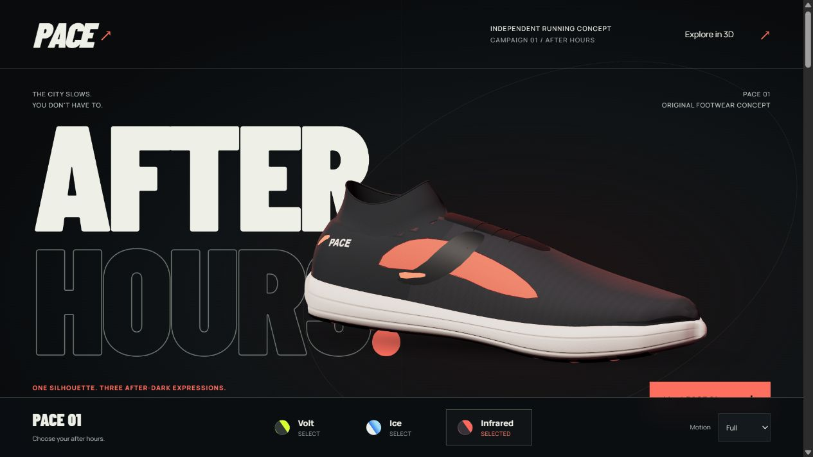
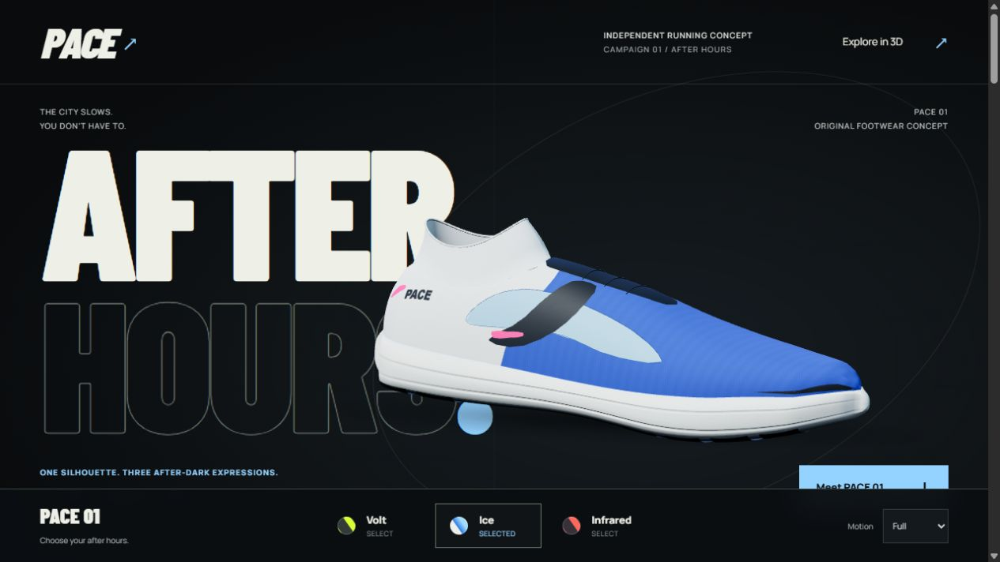
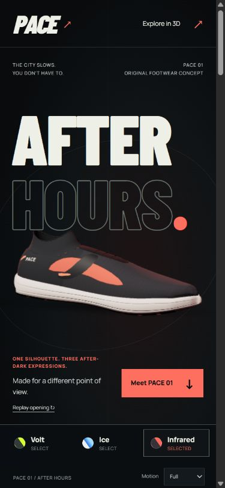

# PACE — publication record

Published October 6, 2026.

- Live campaign: [pace-studio-zeta.vercel.app](https://pace-studio-zeta.vercel.app/)
- Public source: [KareemAl1/pace-studio](https://github.com/KareemAl1/pace-studio)
- Vercel project: `pace-studio`
- Vercel workspace: `kareems-projects-bc520863`
- Connected production branch: `main`

## Deployment configuration

| Setting | Value |
| --- | --- |
| Framework | Vite |
| Install command | `npm ci` |
| Build command | `npm run build` |
| Published directory | `dist` |
| Local verification runtime | Node.js 22.12.0 |
| Vercel build runtime | Node.js 24 |

`vercel.json` defines the install, build and output settings. The production build includes the campaign, 15 finish/view posters, required fonts, favicon and third-party notices. Studio, baseline, local review pages and source documentation remain outside the production output; they are available in the repository.

## Fresh local checks — October 6, 2026

| Check | Result |
| --- | --- |
| `npm run build` | Passed TypeScript checking (`tsc --noEmit`) and the Vite production build. |
| `node tools/check-geometry.mjs` | Passed all geometry, material and transition assertions. |
| Production output inspection | No review, diagnostic, baseline or studio pages, or source maps, found in `dist`. |
| Prepublication tracked-text/history scan | No credential markers found in tracked text and the two commits present at audit time. |
| Local-file exclusions | Environment files, `.vercel`, caches, dependencies, previews, checkpoints and generated build directories are ignored and were not tracked. |

The geometry check reported 7 meshes, 12,848 shoe triangles and 6 generated textures. Attributes were finite; geometry and texture references remained stable across Volt, Ice and Infrared. Palettes were distinct, upper maps were neutral, interrupted transitions were continuous, snapshots were detached, and legacy aliases resolved correctly. The test uses a minimal canvas mock and does not validate browser rendering or visual realism.

Vite emitted its existing chunk-size warning for Three.js: 549.81 kB minified / 138.04 kB gzip. The build succeeded. The scene is loaded separately from the main campaign code, and the static path does not require it.

## Public deployment checks

Checked October 6, 2026, on the public [Vercel deployment](https://pace-studio-zeta.vercel.app/) in the in-app Chromium browser.

| Hosted browser check | Result |
| --- | --- |
| Animated opening | Passed: the full-motion WebGL hero was visible. Replay entered the playing state, exposed Skip, then completed. |
| Finishes | Passed: Volt, Ice and Infrared were visually inspected. Rapid finish changes retained the current manual orientation and zoom. |
| Story | Passed: all four chapters, native scrolling and reverse chapter navigation were exercised. Leaving Explore resumed the story. |
| Explore controls | Passed: mouse dragging, rotation/zoom buttons and ArrowLeft / `+` keyboard input changed the view. Reset restored the default view. Side, Top, Sole and Three-quarter presets, plus the Knit hotspot's open/close controls, were exercised. |
| Phone-sized layout | Passed at 390 × 844 CSS pixels: the hero remained readable with no horizontal overflow. This was a viewport check, not a physical-phone test. |
| Reduced motion | Passed: the complete illustrated story remained available. |
| WebGL context loss | Passed: the actual Test 3D fallback control switched the page to fallback/reduced mode and retained the complete illustrated hero. |

Fresh screenshots from the hosted site:

| Infrared — desktop | Ice — desktop | Phone-sized viewport |
| --- | --- | --- |
|  |  |  |

These are functional and visual smoke checks. No fresh FPS, GPU-completion or input-to-pixel benchmark was collected. Standalone Chrome and physical phones were not tested.

## Earlier visual and performance evidence — October 1, 2026

The [local verification report](after-hours/VERIFY.md), [review gallery](after-hours/review.html) and screenshots in `docs/after-hours/screenshots/` were recorded before public deployment. Dates here use America/New_York; two raw samples have October 2 UTC timestamps. These records document the After Hours design and local browser behavior, not fresh deployment tests.

| Preserved sample | Duration | Render submissions | Render CPU p95 | Accepted input to CPU submission p95 | Observed long tasks |
| --- | ---: | ---: | ---: | ---: | ---: |
| [Warm local production preview, desktop](after-hours/live-desktop-production.json) | 45,147.4 ms | 1,016 | 0.2 ms | 3.9 ms | 0 |
| [Local phone-sized viewport](after-hours/live-phone-viewport.json) | 41,321.6 ms | 633 | 0.2 ms | 3.1 ms | 0 |
| [Cold local development setup](after-hours/live-desktop-cold-dev.json) | 50,134.9 ms | 61 | 0.3 ms | 2.3 ms | 1, lasting 122 ms |

These measurements came from the in-app Chromium browser. The phone-sized viewport was not a physical phone; its timing sample accepted keyboard, preset and reset input, but no phone drag or finish events because the profiler covered the dock. Timing ends at CPU render submission; it does not measure GPU completion, displayed FPS or input-to-pixel latency. Idle submission gaps are expected with demand-driven rendering and are not dropped-frame measurements. Warm samples omit the cold setup cost.

The preserved [canvas recording](after-hours/live-canvas.webm) is a 2.01-second encoded clip from a 12-second wall-clock capture window. It excludes HTML, controls and page background, and the duration discrepancy was not explained. It is not a full-page capture or frame-rate benchmark. No fresh displayed-FPS claim is made for the public deployment.

## Scope and limitations

PACE is an original fictional running-brand and procedural product study with animated storytelling, manual 3D exploration, three finishes and reduced-motion/static fallbacks. It has no commerce or backend services. The shoe is stylized rather than photoreal product photography.

Physical touch devices, broad standalone-browser compatibility, screen readers, GPU/presentation timing, throttled networks and background-tab power usage were not validated by the local build or geometry checks. Consult the dated reports for the exact scope of browser testing.

Font and library notices are retained in the repository and production output. No project-wide open-source license has been selected.
